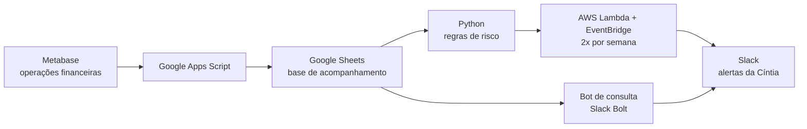
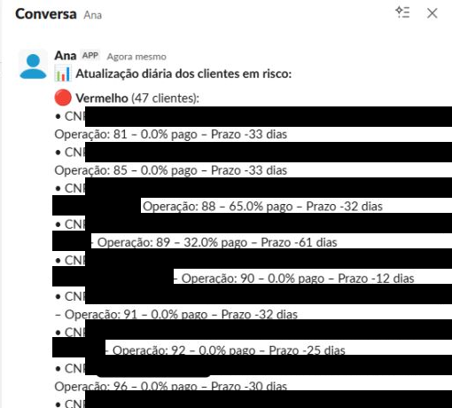
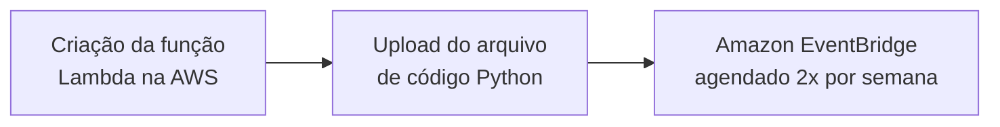

# 🤖 Robô Cíntia — Monitoramento de Inadimplência no Slack

Automação integrada ao **Slack** que monitora e envia, **em tempo real**, o status das operações financeiras para prevenir inadimplências.

🗺️ Fluxos da solução: [Fluxos – FigJam](https://www.figma.com/board/mQzea7hUpx1NZzJP1VwFd1/Fluxos?node-id=0-1&p=f)

## 📈 Impacto

| Métrica | Resultado |
|---|---|
| ⏱️ Tempo economizado | **~6 horas por semana** em tarefas manuais recorrentes |
| 💰 Economia operacional | **~R$ 40 mil por mês** |

## 💡 Muito além da inadimplência

A Cíntia nasceu para prevenir inadimplências no setor de crédito, mas a mesma tecnologia (**previsão + automação + consultas rápidas**) pode ser adaptada a outros contextos:

| Setor | Aplicação |
|---|---|
| 🏥 Saúde | Prever risco de abandono de tratamento ou de custos hospitalares elevados (planos de saúde) |
| 🛒 Varejo | Prever ruptura de estoque e inadimplência no crediário, ou recomendar compras com base em padrões |
| 🎓 Educação | Prever evasão escolar/universitária e automatizar consultas de notas, mensalidades e histórico |
| 👥 Recursos Humanos | Prever turnover e responder a consultas sobre folha, férias e benefícios |
| 🚚 Logística | Prever atrasos em entregas, automatizar consultas de tracking e apoiar a operação em tempo real |
| 🏦 Banco/Fintech | Prever fraudes, automatizar conciliação de extratos, atender clientes e monitorar indicadores financeiros |

Hoje ela funciona integrada ao **Slack**, mas pode ser adaptada para **e-mail, WhatsApp** ou outras plataformas, rodando na **AWS** (com possibilidade de Google Cloud ou Azure).

Basta digitar no Slack palavras como *orçamento* ou *extrato* com o período desejado: a Cíntia reconhece variações de escrita e devolve os resultados formatados, prontos para análise. O resultado é tempo livre para o que importa: **estratégia e tomada de decisão**.

## 🔄 Como funciona



A Cíntia tem duas funções:

| Script | O que faz |
|---|---|
| [`alerta_risco.py`](alerta_risco.py) | **Alerta diário:** classifica cada operação em 🟢 Verde, 🟠 Moderado ou 🔴 Vermelho e envia por DM a lista de clientes em risco |
| [`bot_consulta.py`](bot_consulta.py) | **Consulta sob demanda:** o time pergunta no Slack e a Cíntia responde com orçamentos ou extratos de um CNPJ no período |

## 🚦 Regras de negócio

A classificação é feita em duas etapas: primeiro pelas regras principais e, se o status continuar em branco, pelas regras secundárias.

### 1️⃣ Regras principais — Tempo corrido x Pago

| Status | Condição |
|---|---|
| 🔴 **Vermelho** | Tempo corrido ≥ 71% **e** Pago < Tempo corrido |
| 🟠 **Moderado** | 21% ≤ Tempo corrido ≤ 70% **e** (Tempo corrido − 15) ≤ Pago < Tempo corrido |
| 🟢 **Verde** | 71% ≤ Tempo corrido ≤ 100% **e** Pago ≥ Tempo corrido<br/>**ou** 21% ≤ Tempo corrido ≤ 70% **e** Pago ≥ Tempo corrido<br/>**ou** 0% ≤ Tempo corrido ≤ 20% **e** Pago ≥ 0 |
| ⚪ Em branco | Nenhuma condição se aplica → vai para a regra secundária |

- **Vermelho:** a operação já está avançada (≥ 71% do tempo), mas o pagamento está atrasado em relação ao tempo → alerta.
- **Moderado:** operação no meio do prazo (21–70%) com pagamento até 15 pontos abaixo do tempo corrido → atenção.
- **Verde:** o pagamento acompanha ou supera o tempo corrido, ou a operação ainda está no início (0–20%).

### 2️⃣ Regras secundárias — Valor pago da parcela x Prazo

| Status | Condição |
|---|---|
| 🟢 **Verde** | Valor pago parcela > 0 **e** Prazo ≥ 22 |
| 🟠 **Moderado** | Valor pago parcela = 0 **e** 15 < Prazo ≤ 30<br/>**ou** Valor pago parcela > 0 **e** Prazo < 22 |
| 🔴 **Vermelho** | Valor pago parcela = 0 **e** Prazo ≤ 15 |
| ⚪ Em branco | Nenhuma condição satisfeita |

- **Verde:** há pagamento e prazo suficiente → situação boa.
- **Moderado:** sem pagamento e prazo entre 16 e 30 dias, ou com pagamento mas prazo curto → atenção.
- **Vermelho:** sem pagamento e prazo muito curto → crítico.

### Exemplo de alerta no Slack



*Nomes e CNPJs das oficinas ocultados.*

## 💬 Bot de consulta

Mensagens aceitas no Slack:

```
Orçamento CNPJ 12345678000199 - 01/06/2025 a 30/06/2025
Extrato CNPJ 12345678000199 - 01/06/2025 a 30/06/2025
```

- **Orçamento:** orçamentos autorizados ou realizados das seguradoras parceiras no período, com placa, status, data e valor líquido.
- **Extrato:** depósitos PIX recebidos das seguradoras no período.

## ▶️ Como executar

```bash
pip install -r requirements.txt
cp .env.example .env   # preencha com seus tokens e links das planilhas
python alerta_risco.py     # envia o alerta diário
python bot_consulta.py     # sobe o bot de consulta
```

## ☁️ Deploy na AWS

Em produção, o alerta rodava de forma automática na nuvem da empresa:



1. **Criação da função Lambda** na AWS.
2. **Upload do código Python** (`alerta_risco.py` e dependências) para a função.
3. **Agendamento no Amazon EventBridge** para disparar o alerta **2 vezes por semana**.

> A infraestrutura ficava na conta AWS da empresa e não faz parte deste repositório.

## 🧰 Ferramentas

Python · pandas · Slack SDK / Slack Bolt · AWS Lambda · Amazon EventBridge · Google Apps Script · Google Sheets · Metabase

> ⚠️ Dados de clientes e credenciais (tokens do Slack, links das planilhas) **não fazem parte deste repositório**. Configure-os via `.env`.
